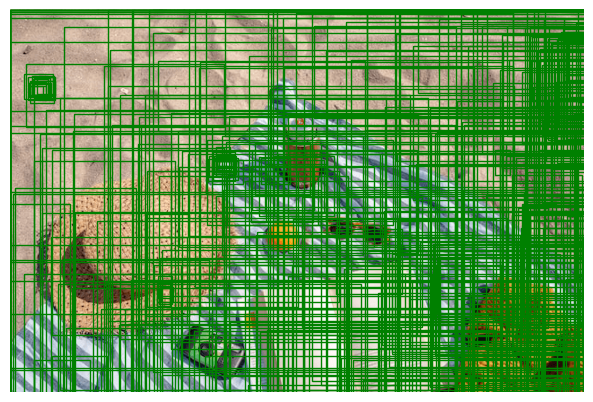
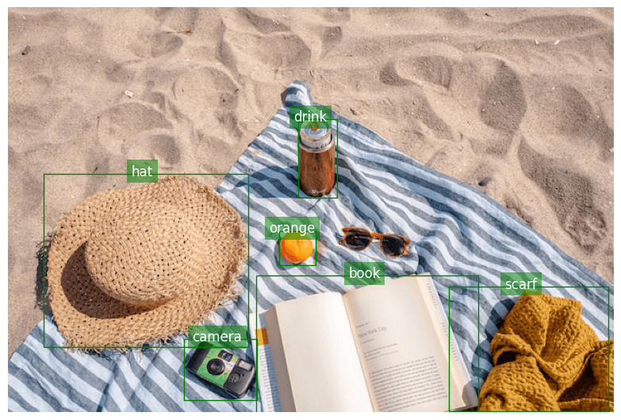

# CLIP Zero-Shot Object Detection

An implementation of zero-shot and open-vocabulary object detection combining OpenAI's CLIP with a Faster R-CNN Region Proposal Network (RPN).

This pipeline detects and localizes arbitrary visual concepts using natural language queries without requiring task-specific fine-tuning or retraining on labeled object detection datasets.

---

## Overview

Traditional object detection architectures are restricted to predefined, closed-set label spaces (e.g., COCO's 80 classes). This pipeline integrates class-agnostic region proposal generation with multi-modal embeddings from CLIP to enable open-vocabulary queries:

1. **Region Proposal**: Extracts candidate object bounding boxes using a Faster R-CNN RPN backbone.
2. **Visual Embedding**: Encodes proposed image patches into the latent embedding space using the CLIP visual encoder.
3. **Text Embedding**: Encodes target text queries (and optional negative prompts) into the same joint embedding space.
4. **Scoring and Ranking**: Evaluates cosine similarity between image regions and text queries, applying confidence normalization and thresholding to produce ranked detections.

---

## Visual Results

| Input Image | Proposed Regions (RPN) | Zero-Shot Detection Output |
| :---: | :---: | :---: |
|  |  |  |

---

## Features

- **Open-Vocabulary Detection**: Localize arbitrary target classes specified via natural language prompts.
- **Negative Prompt Suppression**: Filter out ambiguous matches and background noise by contrasting target prompts against negative descriptors.
- **Multi-Scale Context Analysis**: Evaluates candidate proposals across varying context scales (0.8x, 1.0x, 1.2x) to refine spatial coverage.
- **Confidence Calibration**: Normalizes raw similarity distributions into bounded confidence scores for threshold tuning.

---

## Getting Started

### Prerequisites

- Python 3.9 or higher
- PyTorch (CUDA recommended for GPU acceleration)

### Installation

```bash
git clone https://github.com/Benbakreti0Amine/clip-zero-shot-object-detection.git
cd clip-zero-shot-object-detection

# Create and activate virtual environment
python -m venv venv
# On Windows:
.\venv\Scripts\activate
# On Linux/macOS:
# source venv/bin/activate

# Install dependencies
pip install -r requirements.txt
```

---

## Usage

The complete pipeline, inference workflow, and visual inspections are implemented in [`clip_object_detection.ipynb`](clip_object_detection.ipynb).

To launch the notebook:

```bash
jupyter notebook clip_object_detection.ipynb
```

### Python API Example

```python
import torch
import clip

device = "cuda" if torch.cuda.is_available() else "cpu"

# Load CLIP model and preprocessing pipeline
model, preprocess = clip.load("ViT-B/32", device=device)

# Target queries and negative suppression prompts
positive_prompts = ["a dog", "a pet"]
negative_prompts = ["background", "floor", "furniture"]

# Refer to clip_object_detection.ipynb for complete bounding box extraction and scoring
```

---

## Repository Structure

```text
├── assets/
│   ├── CLIP.png                # Model architecture diagram
│   ├── original_image.png      # Sample test image
│   ├── regions.png             # Candidate bounding box proposals
│   └── clip_result.png         # Zero-shot detection output
├── clip_object_detection.ipynb # End-to-end interactive notebook
├── requirements.txt            # Dependency specifications
├── LICENSE                     # MIT License
└── README.md                   # Project documentation
```

---

## References

- Radford, A., et al. (2021). *Learning Transferable Visual Models From Natural Language Supervision*. [arXiv:2103.00020](https://arxiv.org/abs/2103.00020).
- Ren, S., He, K., Girshick, R., & Sun, J. (2015). *Faster R-CNN: Towards Real-Time Object Detection with Region Proposal Networks*. [arXiv:1506.01497](https://arxiv.org/abs/1506.01497).

---

## Author

**Mohammed El Amine Benbakreti**  
GitHub: [@Benbakreti0Amine](https://github.com/Benbakreti0Amine)

---

## License

Distributed under the MIT License. See [LICENSE](LICENSE) for details.
